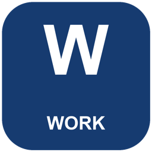
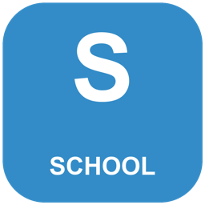
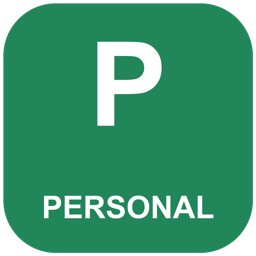
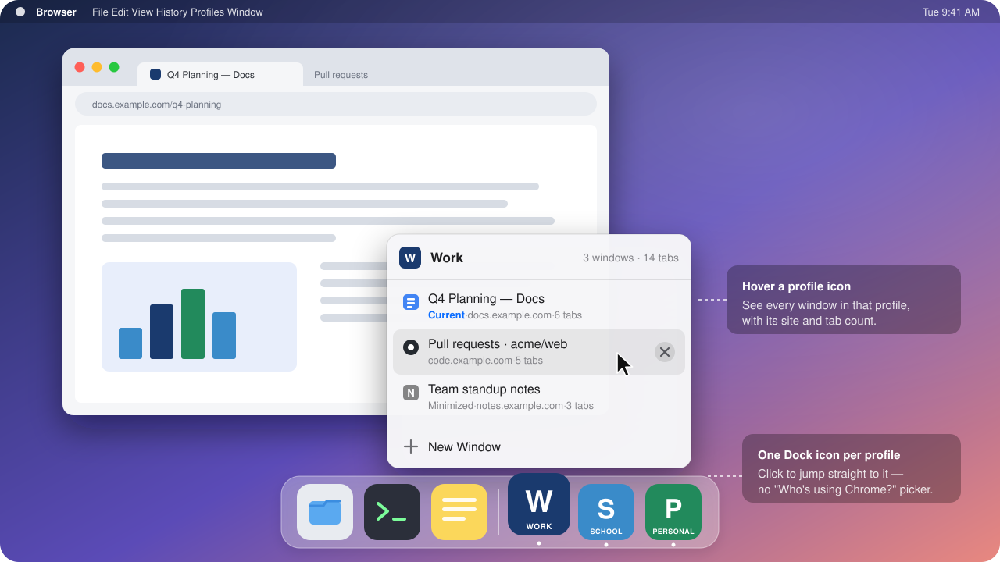
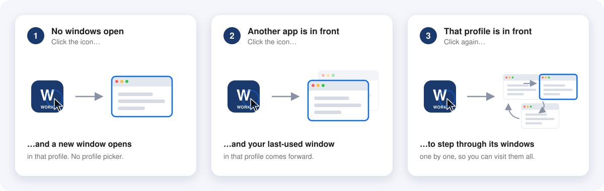
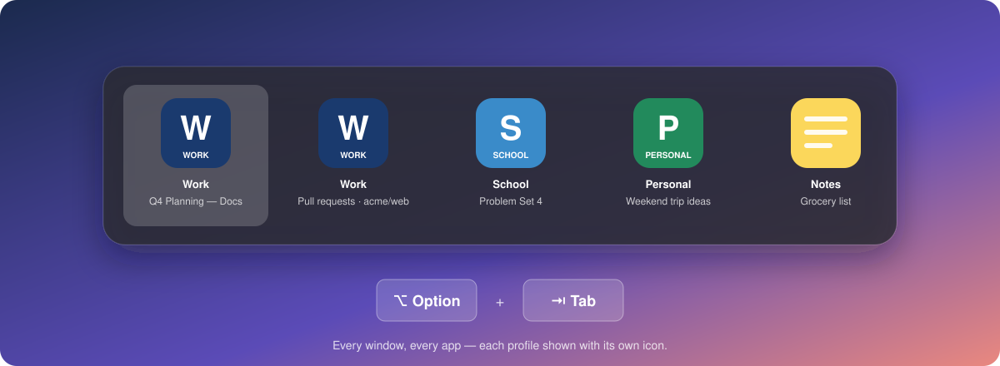
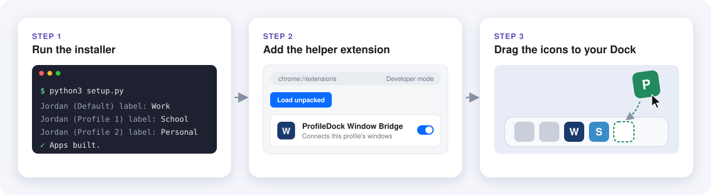

<div align="center">

&nbsp;
&nbsp;


# ProfileDock

### Give every Chrome profile its own Dock icon on your Mac.

Work, school, personal — one click takes you straight to the right profile's windows.<br>
No more digging through a pile of identical Chrome windows. No more "Who's using Chrome?"


<br>



</div>

---

## Why ProfileDock?

If you use more than one Chrome profile, you know the problem: every window is just "Chrome." Your work email, your class portal and your personal tabs all hide behind the same icon, and finding the right one means clicking around until it shows up.

ProfileDock fixes that:

- 🎯 **One icon per profile.** Each profile gets its own colored, labeled icon in the Dock, so you can tell them apart at a glance.
- 👀 **See your windows before you switch.** Hover an icon to list that profile's windows, with the site and tab count for each.
- ⚡ **One click, right window.** Click to jump to that profile — never through Chrome's profile picker.
- 🔒 **Private by design.** No account, no analytics, no internet connection. Nothing leaves your Mac.

---

## What it looks like

### Hover to see every window

Rest the pointer on a profile icon and a list of its windows pops up. Click a row to go there, close a window with **×**, or open a fresh one with **New Window**. The list updates live while it's open.

- **Current** marks the window you're looking at.
- **Last used** marks the one a click on the icon will bring back.
- Minimized windows are listed too, dimmed.

Prefer menus? **Right-click** the icon to see the same windows as a regular Dock menu.

### Click to go straight there

A click on a profile icon always does something useful:



### Switch between everything with Option + Tab

ProfileDock adds a window switcher that shows **every window from every app**, with each Chrome profile under its own icon. Hold **Option**, tap **Tab** to move along, and let go to switch. You can also click a tile, or press **Esc** to cancel.



### Extras for nicer windows

- **Green button fills the screen** without going into full-screen mode (Option-click it for real full screen).
- **Minimize goes to the right place:** a minimized profile window tucks into *its own* profile icon, not Chrome's.
- **Chrome's own icon skips the picker too:** with no windows open, it reopens the profile you used last.

---

## Get started



### What you need

- A Mac with **Google Chrome** (Chrome's language set to English)
- **Python 3.10 or newer** — check with `python3 --version`
- Apple's **command line tools** — install with `xcode-select --install` if you haven't already

### 1. Download and run the installer

Open **Terminal** and run:

```sh
git clone https://github.com/90Ismail/ProfileDock.git
cd ProfileDock
python3 setup.py
```

It finds your Chrome profiles and asks for a short label for each one (like *Work*, *School* or *Personal*). Press **Enter** to keep a profile's current name.

> 💡 **Want your Google profile picture as the icon?** Run `pip3 install pillow` before `setup.py`. Without it you get a clean colored letter icon like the ones above.

### 2. Add the helper extension to each profile

In each Chrome profile:

1. Go to `chrome://extensions`.
2. Turn on **Developer mode** (top-right corner).
3. Click **Load unpacked** and choose the folder the installer printed for that profile.

The extension is what lets ProfileDock see that profile's windows.

### 3. Put the icons in your Dock

Open the **apps** folder the installer printed and drag each profile's icon into your Dock.

### 4. Allow Accessibility access

When macOS asks, allow **ProfileDock Agent** under **System Settings → Privacy & Security → Accessibility**. It needs this to show the hover list and switch windows.

**That's it!** To check that every profile is connected, run:

```sh
python3 setup.py --status
```

> A profile with no open windows shows as *not connected*. That's normal: Chrome pauses its extension until a window opens.

---

## Your privacy

ProfileDock runs entirely on your Mac.

- ❌ No accounts, sign-ups or analytics
- ❌ No network requests of any kind
- ❌ Never reads page contents or passes along full web addresses
- ✅ Only window titles, tab counts and site names (like `github.com`) pass from Chrome to the Dock, through local files

It doesn't touch your Chrome profiles, bookmarks or browsing data.

---

## Customize

Rename profiles or change their look anytime by running `python3 setup.py` again. Everything updates in place.

To set things by hand, save a config file and point the installer at it. Each profile can have a `label`, its Chrome folder, and optionally a `color` (`[r, g, b]`) or a custom `icon` image:

```json
{
  "work":   {"label": "Work",   "chromeDirectory": "Default",   "color": [26, 58, 110]},
  "school": {"label": "School", "chromeDirectory": "Profile 1", "color": [58, 139, 201]}
}
```

```sh
python3 setup.py --config my-profiles.json
```

---

## Troubleshooting

<details>
<summary><b>A profile says "not connected"</b></summary>

Run `python3 setup.py --status`. It tells you whether that profile's extension is missing, out of date, or simply has no windows open.

If you're updating from a very old version (extension older than 0.2.0), click the ↻ reload button on ProfileDock in `chrome://extensions` once in each profile. Restarting Chrome isn't enough for that one-time update.
</details>

<details>
<summary><b>A click opens the profile through Chrome's Profiles menu</b></summary>

That's the backup route while the extension is still connecting. You'll still land in the right profile.
</details>

<details>
<summary><b>Opening Chrome from Spotlight or Launchpad shows the profile picker</b></summary>

Untick **Show on startup** at the bottom of the "Who's using Chrome?" window.
</details>

<details>
<summary><b>An icon looks old after changing it</b></summary>

Remove that icon from the Dock and drag it in again from the apps folder.
</details>

<details>
<summary><b>Where are the logs?</b></summary>

- Agent: `~/Library/Application Support/ProfileDock/agent.log`
- Bridge errors: `bridge/host.log` in this folder
</details>

---

## Uninstall

1. Drag the profile icons out of the Dock.
2. In Terminal, stop the Agent and delete its files:

   ```sh
   launchctl bootout gui/$(id -u)/local.profiledock.agent
   rm ~/Library/LaunchAgents/local.profiledock.agent.plist
   rm -r ~/Library/Application\ Support/ProfileDock
   ```
3. Remove the extension from each Chrome profile, and remove **ProfileDock Agent** from Accessibility in System Settings.

Your Chrome profiles and browsing data are left untouched.

---

<details>
<summary><b>How it works (under the hood)</b></summary>

<br>

`setup.py` installs four small pieces:

| Piece | What it does |
|---|---|
| **A launcher app per profile** (`Chrome Work.app`, …) | The icon you put in the Dock. |
| **A Chrome extension per profile** | Reports that profile's windows. |
| **A local bridge** (`bridge/native_host.py`) | Started by Chrome for the extension; passes window lists to the Dock and commands back to Chrome. |
| **ProfileDock Agent** | A background helper started at login. Draws the hover list and switcher, handles window buttons, and keeps launchers responsive. Needs Accessibility permission. |

Clicks follow simple rules: with no windows, open one; from another app, bring back the profile's most recently used window; from that profile, move to its next window. Minimized windows stay put while a visible one can be shown, and a double-click counts as one click.
</details>

<details>
<summary><b>Simple version without the extension</b></summary>

<br>

`build.py` builds an older, simpler variant: AppleScript launchers that pick the profile from Chrome's Profiles menu, plus a helper that learns windows as you use them. It can't list a profile's windows until you've visited them, and it has no hover list, so use `setup.py` unless you can't install the extension.

```sh
pip install -r requirements.txt
python build.py --config profiles.local.json --output "$HOME/Applications/ProfileDock"
```

See `profiles.example.json` for its configuration format.
</details>

<details>
<summary><b>Development and tests</b></summary>

<br>

```sh
python3 -m unittest discover -s tests -v
```

The tests cover the bridge, which window a Dock click picks (`bridge/WindowChoice.swift`, built with the Xcode tools), the Chrome extension against a fake Chrome API (needs Node.js), and the `--status` messages and `build.py` configuration checks. Tests skip what the machine can't run. Window switching itself needs real Chrome profiles and macOS permissions, so test it by hand.
</details>

---

<div align="center">

**MIT licensed.** An independent project, not affiliated with Google or Apple.<br>
If ProfileDock saves you some clicks, consider giving it a ⭐

</div>
